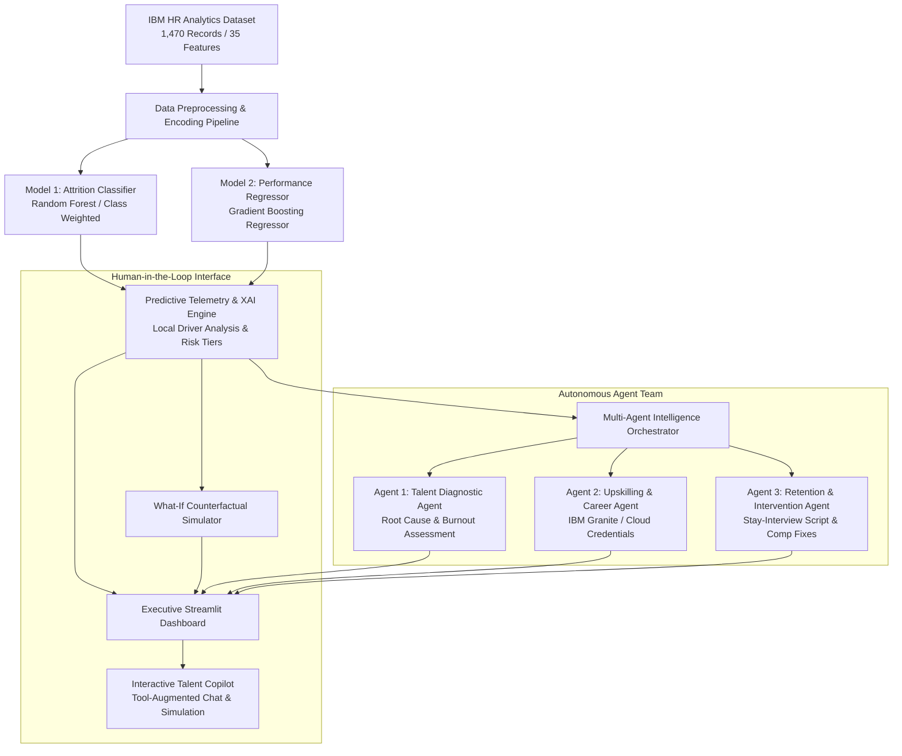

# 💼 TalentPulse — Enterprise Performance & Retention Intelligence System
### *Autonomous Workforce Analytics & Retention Copilot powered by Dual IBM ML Models and Agentic AI*

[](https://www.python.org/)
[-green.svg)](https://scikit-learn.org/)
[](#-agentic-ai-architecture)
[](https://streamlit.io/)

---

## 📌 Executive Summary

Modern enterprise HR and talent management often struggle with **passive, reactive turnover**—discovering an employee is dissatisfied only after they tender their resignation. 

While traditional machine learning projects merely predict a number or classification (e.g., *"Student score = 65%"* or *"Attrition = Yes"*), **TalentPulse elevates predictive analytics into Agentic AI**. It pairs **dual machine learning models** with **Explainable AI (XAI)**, a **counterfactual "What-If" simulation engine**, and a **team of autonomous AI agents** that:
1. **Diagnose** the root causes of flight risk (burnout, promotion plateaus, comp gaps).
2. **Formulate** tailored IBM upskilling blueprints and career progression roadmaps.
3. **Generate** actionable retention packages, manager stay-interview scripts, and VP escalation memos.
4. **Interact** through a conversational AI Copilot capable of real-time tool execution.

---

## 🏗️ System Architecture



---

## 🔬 Machine Learning Pipeline

### 1. Dataset
Built on the canonical **IBM HR Analytics Employee Attrition & Performance Benchmark** (1,470 employee records, 35 features) encompassing:
* **Workload & Fatigue:** `OverTime`, `BusinessTravel`, `DistanceFromHome`
* **Engagement & Satisfaction:** `WorkLifeBalance`, `JobSatisfaction`, `EnvironmentSatisfaction`, `JobInvolvement`
* **Progression & Career Velocity:** `YearsSinceLastPromotion`, `YearsInCurrentRole`, `YearsAtCompany`, `JobLevel`
* **Compensation & Incentives:** `MonthlyIncome`, `PercentSalaryHike`, `StockOptionLevel`

### 2. Dual Models & Performance Metrics
* **Model 1: Attrition Risk Classifier (`RandomForestClassifier`)**
  * Tuned with balanced class weights to address natural turnover imbalance.
  * Evaluated across **Accuracy**, **ROC-AUC**, **Precision**, **Recall**, and **F1-Score**.
* **Model 2: Performance Score Regressor (`GradientBoostingRegressor`)**
  * Evaluated across **Mean Absolute Error (MAE)**, **Root Mean Squared Error (RMSE)**, and **R² Variance Explained**.
* **Explainable AI (XAI):**
  * Deconstructs predictions into localized risk factors (e.g., `OverTime = Yes (+22% risk)`, `YearsSinceLastPromotion >= 5 (+18% risk)`) and retention anchors.

---

## 🤖 Agentic AI Architecture

TalentPulse implements a **Hybrid LLM Client** supporting **IBM Watsonx.ai (IBM Granite models)**, **OpenAI / Groq API**, and an **Offline Smart Heuristic Engine** that runs 100% reliably without requiring external API keys.

| Autonomous Agent | Core Function | Primary Deliverable |
|---|---|---|
| **🔍 Talent Diagnostic Agent** | Assesses quantitative risk drivers and psychological contract friction. | Root Cause Breakdown, Flight Window Urgency (30/60/90 days), Burnout Indicators. |
| **🚀 Upskilling & Career Strategy Agent** | Re-accelerates career velocity with industry-recognized credentials. | IBM Enterprise Design Thinking, IBM Granite/AI badges, 6-Month Promotion Milestone timeline. |
| **🛡️ Retention & Intervention Action Agent** | Prepares actionable HR interventions and dialogue guides. | 12–15% Comp Realignment proposal, Manager 1-on-1 Stay-Interview dialogue script, VP Escalation Memo. |
| **💬 Talent Copilot (Interactive Agent)** | Real-time assistant with tool calling and simulation execution. | Handles natural language queries, triggers counterfactual simulations, and drafts letters. |

---

## 💻 Streamlit Executive Application Features

1. **📊 Executive Workforce Analytics:**
   * Macro KPI cards, department turnover breakdown, overtime burnout impact, and high-risk employee rosters.
2. **👤 Micro Talent Audit & XAI:**
   * Interactive Attrition Flight Risk gauge, Performance Trajectory meter, and localized positive/negative factor decomposition.
3. **🧪 Counterfactual "What-If" Simulator:**
   * Adjust sliders (e.g., eliminate overtime, increase salary hike, grant promotion) and see risk drop in real time.
4. **🤖 Multi-Agent Intervention Center:**
   * Trigger the 3 autonomous agents with 1 click to generate an executive dossier ready for download as Markdown.
5. **💬 Interactive Talent Copilot:**
   * Chat directly with the AI, ask questions about employee motivations, and simulate retention scenarios in natural language.

---

## 🚀 Setup & Execution Guide

### Prerequisites
* Python 3.10, 3.11, 3.12, 3.13, or 3.14 installed.

### Step 1 — Navigate to the project folder
```powershell
cd "talent_pulse"
```

### Step 2 — Install dependencies
```powershell
pip install -r requirements.txt
```

### Step 3 — Generate the benchmark dataset
```powershell
python data/generate_ibm_hr_data.py
```

### Step 4 — Train the dual ML models
```powershell
python ml_engine/train_models.py
```
*This will evaluate the models and save the trained artifacts to `ml_engine/models/`.*

### Step 5 — Launch the Executive Dashboard
```powershell
streamlit run app.py
```
Open your browser at `http://localhost:8501`.

---

## 🌟 How This Project Compares to Starter Projects

| Dimension | Basic Starter Project (e.g., Student Score) | **TalentPulse (IBM ML & Agentic AI)** |
|---|---|---|
| **Domain** | Academic score prediction | **Enterprise Workforce Intelligence & Retention** |
| **Dataset** | 4 synthetic features | **IBM HR Benchmark (35 features, 1,470 records)** |
| **ML Models** | 1 simple Linear Regression | **Dual Models: Random Forest Classifier + Gradient Boosting Regressor** |
| **Explainability** | None | **Local Explainable AI (XAI) risk driver breakdown** |
| **Simulation** | None | **Counterfactual "What-If" Scenario Simulator** |
| **Agentic AI** | None | **3 Specialized Autonomous Agents + Interactive Copilot with Tool Calling** |
| **IBM Alignment**| None | **IBM Watsonx.ai / Granite integration + IBM credentials roadmap** |
| **Interface** | Basic HTML form | **Executive Streamlit Analytics Dashboard with interactive Plotly charts** |

---

## 👨‍💻 Internship Presentation Talking Points

When presenting this project to your IBM evaluators or mentors:
1. **Highlight the Evolution from Prediction to Action:** *"Standard ML predicts who might leave; Agentic AI reasons about why they are leaving and autonomously plans how to retain them."*
2. **Demonstrate Counterfactual Simulation:** *"In Tab 3, show how policy changes (capping overtime + 15% salary hike) directly lower risk by over 30 percentage points."*
3. **Showcase Multi-Agent Collaboration:** *"Click 'Dispatch Autonomous Multi-Agent Audit' to demonstrate how the Diagnostic Agent feeds into the Upskilling Agent, which feeds into the Retention Strategist."*
4. **Discuss IBM Ecosystem Relevance:** *"The project uses the canonical IBM HR dataset, references IBM Granite/Watsonx architectures, and incorporates IBM professional credentialing tracks."*
